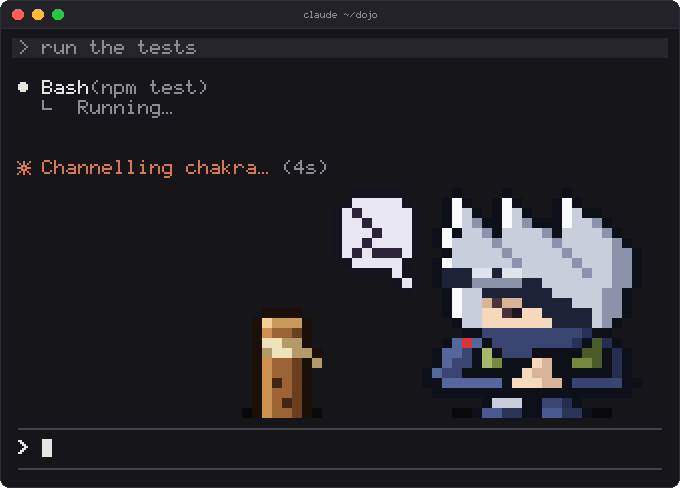
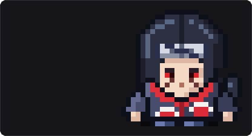
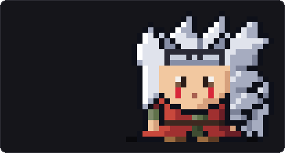
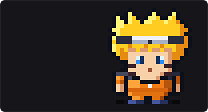
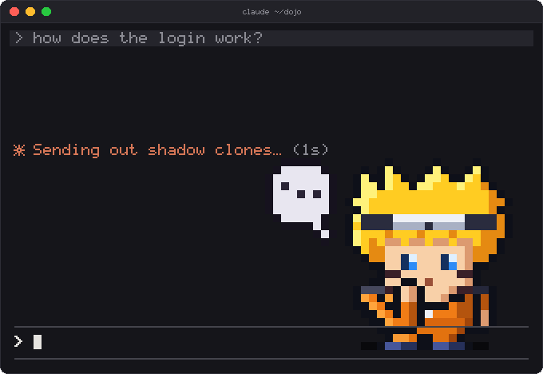
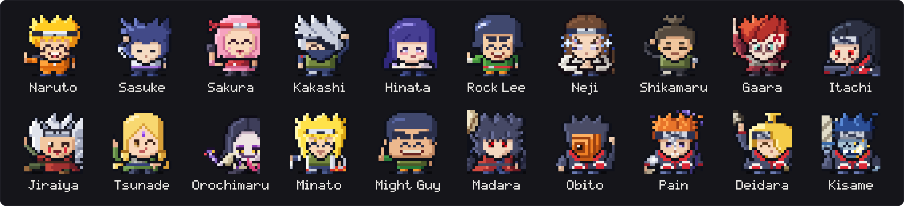

# naruto

<p align="center">
  
</p>

A pixel-art chibi ninja lives in the corner above your Claude Code prompt and
fights while Claude works. There are twenty characters from the series, each
drawn by hand in pixels, head to toe, with eyes that blink and look around,
faces that follow Claude's work, and three jutsu of their own. Among them are the
Rasengan, Chidori, Tsukuyomi, Sand Coffin, Shinra Tensei, Kamui, and
summonings of Gamabunta, Pakkun, Katsuyu, Manda and the Nine-Tails. Each jutsu
plays across a little arena at a wooden training post.

```
/plugin install naruto --marketplace i-harsha-reddy/naruto-mod
```

Then run `/reload-plugins`, or start a new session.

Kakashi is your ninja to begin with. Pick another with `/ninja <name>`, like
`/ninja itachi`, or watch a jutsu any time with `/ninja jutsu`.

<p align="center">
  
  
  
</p>

## Requirements

- Claude Code 2.1.292 or later. Mods are in early access; this one is tested
  on 2.1.296.
- A terminal, or the Claude desktop app. The VS Code extension's chat panel
  doesn't show mods.

## What it does

| When | Your ninja |
| --- | --- |
| You're idle | Breathes, blinks and glances around. A couple of minutes after you step away, a round of training at the post |
| Claude thinks | Looks up in thought, with a "…" bubble |
| Claude reads or searches | Thinks it over, with a magnifier bubble. Kakashi gets his book out |
| Claude edits | A quick strike at the post, and a kunai bubble |
| Claude runs a command | A quick strike. If it is still running a few seconds later (tests, a build), the signature jutsu: hand signs, gathering chakra, the attack, the impact |
| A subagent runs | A summoning or clones, for Naruto, Sakura, Kakashi, Itachi, Jiraiya, Tsunade, Orochimaru and Obito. Madara drops a meteor. The rest use their next jutsu |
| Claude works for a long time | Weaves hand signs between jutsu. The jutsu come less often the longer a turn runs, so they never wear thin |
| A command or an edit fails | The jutsu fizzles, and they slump with a sweat drop |
| A turn ends with an answer | Their own cheer: a thumbs-up, crossed arms and a smirk, Hinata's shy finger-poke, Kakashi's eye-smile. A green tick stays until your next prompt, or until they doze off |
| You switch ninja | A puff of smoke, a hello, then their signature jutsu |
| You stay away five minutes | Gets drowsy, then dozes off. Naruto wears his nightcap. Gaara never sleeps |

<p align="center">
  
</p>

In the terminal, the spinner shouts each jutsu's name as it lands
("Chidori!"). Neji counts his palms out loud: "Two Palms!", "Four Palms!",
all the way to "Sixty-Four Palms!". The rest of the time the spinner speaks in
the ninja's voice ("Eating ramen at Ichiraku…"), and the line under a finished turn says how
long it took in their words ("Believed it for 12s"). Claude's own replies stay
exactly as they are.

The first time you start Claude Code with the mod, your ninja says hello with
their signature jutsu and suggests `/ninja list`. If you set
`prefersReducedMotion` in Claude Code's settings, the ninja keeps their poses
and bubbles but skips jutsu and shouts.

## The roster



**Hidden Leaf:** Naruto, Sasuke, Sakura, Kakashi, Hinata, Rock Lee, Neji,
Shikamaru, Jiraiya, Tsunade, Minato, Might Guy.

**Akatsuki:** Itachi, Obito, Pain, Deidara, Kisame.

**Elsewhere:** Gaara, Orochimaru, Madara.

Nicknames work too: `/ninja tobi`, `/ninja nagato`, `/ninja pervy sage`,
`/ninja yondaime`, `/ninja gai`. Ask for someone who isn't here yet, like
`/ninja hashirama`, and they'll point you to someone who is.

## Commands

| Command | What it does |
| --- | --- |
| `/ninja` | Your ninja and their three jutsu |
| `/ninja <name>` | Switch ninja (any part of the name, or a nickname) |
| `/ninja list` | All twenty, by side, with yours marked |
| `/ninja random` | A surprise ninja |
| `/ninja jutsu [1-3 or name]` | Watch one of their jutsu now |
| `/ninja quiet` | Calm: the ninja stays, but no jutsu or training, and the spinner and footer keep Claude's own words |
| `/ninja off` | Hide the ninja and their words |
| `/ninja on` | Back to normal, from quiet or hidden |
| `/ninja help` | All of the above |

## Turning it down

- `/ninja quiet` stops the jutsu but keeps the ninja. `/ninja off` hides them
  and their voice in the spinner. `/ninja on` brings everything back.
- `ctrl+x ctrl+a` folds the band above the prompt away. That is Claude Code's
  own binding.
- `claude plugin disable naruto` switches the mod off, and
  `claude plugin uninstall naruto` removes it.

## Where it looks best

The ninja takes 48 columns by 12 rows. In a shorter band (for example when
Claude Code's tasks list opens under the prompt), the bottom rows are hidden
and the ninja keeps their size and place. With 8 rows or fewer, or in a
terminal narrower than 53 columns, you see just the ninja without the arena,
then only their name. On the main screen (not fullscreen), the band takes
about a third of the terminal's height.

- **Every terminal** (Terminal, iTerm2, Ghostty, kitty, WezTerm, VS Code,
  JetBrains IDEs) draws the sprite with half-block characters, two pixels to a
  cell, so they all show the same thing. It looks best in 24-bit colour, and
  256-colour terminals get the nearest colours.
- **The Claude desktop app** draws the same pixel art, crisp at any size.

JetBrains IDE terminals support 24-bit colour without announcing it. To turn
it on, add this to `~/.zshrc` (or `~/.bashrc`) and start a new session:

```
[[ "$TERMINAL_EMULATOR" == "JetBrains-JediTerm" ]] && export COLORTERM=truecolor
```

### Don't see the ninja?

- You may have hidden them with `/ninja off`. `/ninja on` brings them back.
- The full stage needs a band of 12 rows: on the main screen, a terminal about
  36 rows tall. From 27 rows you see the arena with the ninja's legs cut off;
  below that, the ninja's head, then just their name.
- While Claude Code shows a survey, a permission prompt or a question, the
  dialog has the band. Your ninja is back as soon as you answer.
- Mods don't load when your settings turn plugin hooks off (`disableAllHooks`
  or `allowManagedHooksOnly`).
- The band may be folded away: press `ctrl+x ctrl+a`.
- After installing, start a new session or run `/reload-plugins`.

## Privacy

The mod reacts to which tool Claude is using (a command, an edit, a search)
and when a turn starts and ends. It never stores or sends what Claude reads,
writes or runs. It stores your ninja's name and three settings (whether you've
been welcomed, quiet mode, and whether the ninja is hidden). It makes no
network requests.

## How it is built

All twenty ninja are drawn natively. Their bodies, their jutsu and the effects
are hand-placed letter grids, stamped pixel for pixel and never scaled,
rotated or blurred.

- `hooks/sprite/`: the sprite engine. `types.ts` describes the format:
  - outfit templates drawn once in semantic letters (`templates/`);
  - each ninja's palette, head, eyes, props and poses (`ninja/<id>.ts`);
  - the effect library and the summons (`fx/`);
  - moves as lists of cels, each held for a number of frames
    (`anims/<id>.ts`). `anims/kit.ts` holds the motion they share: moving
    holds, weighted casts, leaps and hops home, run-ins and the post's poof.

  `compose.ts` stamps a frame from them.
- `hooks/art/pixel.ts`: the renderer. It sets the sprite engine's stage in the
  band, adds the badges, and turns it into half-block cells for the terminal
  or an SVG for the desktop app.
- `hooks/art/move.ts` and `hooks/art/moves.ts`: a move's timing (its beats,
  the shout, the blow) and which move plays.
- `hooks/palette.ts`: the nearest-colour match for 256-colour terminals.
- `hooks/art/chibi.ts` and `hooks/art/portrait.ts`: the state the companion
  hands the renderer (the pose, the face, the move playing).
- `hooks/companion.ts`: what the ninja does from moment to moment, and when it
  fights. `hooks/signs.ts` weaves the hand signs between jutsu.
- `hooks/roster.ts` and `hooks/lines.ts`: the twenty ninja (names, nicknames,
  quotes, cheers) and the lines they say in the spinner.
- `hooks/register.tsx`: the hooks that connect it to Claude Code.

### Working on it

You need Node 22.18 or later for the scripts. They run TypeScript directly.

- `claude plugin validate .` checks the mod, and `claude plugin test .` runs
  its tests.
- `node scripts/pixels.mjs kakashi move:0` renders a jutsu frame by frame
  into `.preview/`.
- `node scripts/animate.mjs` writes a page that plays every jutsu.
- `node scripts/motion.mjs` checks every move against the animation rules:
  no frozen holds, no shudder, no hovering, no effect that vanishes in a
  frame, a real step into each blow.
- `node scripts/media.mjs` regenerates the pictures in `media/`.
- To type-check with `npx -p typescript tsc -p .`, first load the mod once in
  Claude Code (`claude --plugin-dir .`). Claude Code writes the type
  definitions that `tsconfig.json` extends into `.claude-plugin/types/`.

## Credits

All art is original and drawn in code. Nothing is copied from the anime or the
games. This is a fan-made tribute, not affiliated with or endorsed by the
rights holders. Naruto and its characters are © Masashi Kishimoto / Shueisha,
TV Tokyo, Pierrot.

Released under the [MIT License](LICENSE).
